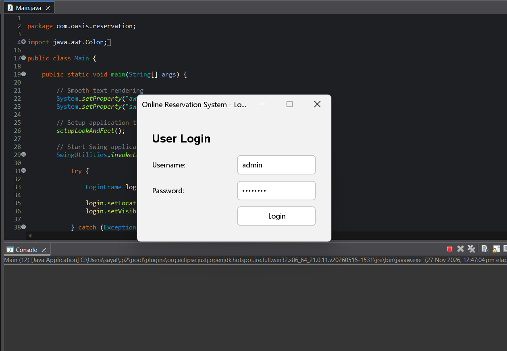
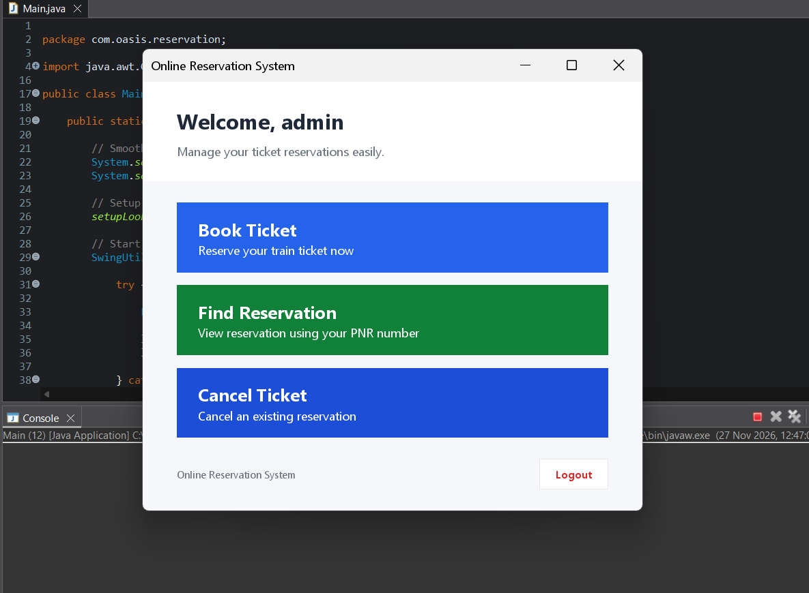
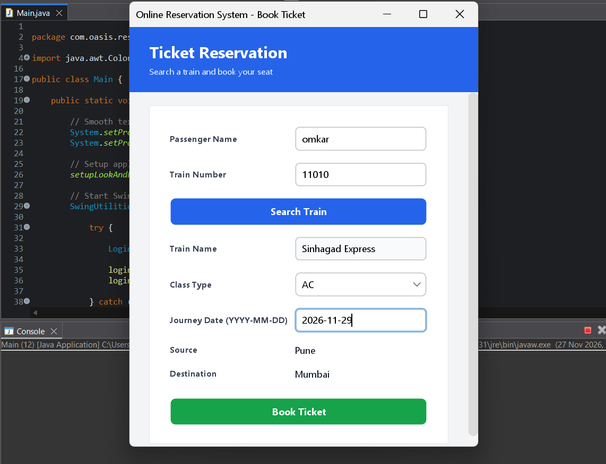
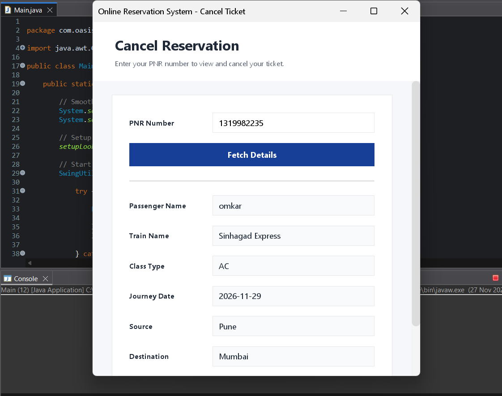

# Online Reservation System

A desktop-based Online Reservation System developed using **Core Java, Java Swing, JDBC, and MySQL** as part of the **Oasis Infobyte Java Development Internship – Task 1**.

The application allows users to log in, search for train details, book train tickets, generate unique PNR numbers, and cancel reservations using their PNR number.

## Project Overview

The Online Reservation System is designed to simplify the railway ticket reservation process through a graphical user interface.

Users can log in using their credentials, enter passenger and journey details, book tickets, and cancel existing reservations.

The application uses JDBC to connect the Java application with a MySQL database for storing and managing reservation information.

## Technologies Used

| Technology | Purpose |
|---|---|
| Java 21 | Core application development |
| Java Swing | Graphical User Interface |
| JDBC | Database connectivity |
| MySQL | Database management |
| Maven | Dependency management |
| Eclipse IDE | Development environment |
| Git & GitHub | Version control and project hosting |

## Features

### 1. User Login
- Username and password authentication.
- Validates user credentials against the database.
- Displays an error message for invalid credentials.

### 2. Dashboard
- Displays a welcome message.
- Provides navigation to ticket booking and cancellation.
- Includes a logout option.

### 3. Train Search
- Search trains using train numbers.
- Automatically retrieves train name, source, and destination.
- Displays an error message for invalid train numbers.

### 4. Ticket Reservation
- Enter passenger details.
- Select train class.
- Enter journey date.
- Retrieve train information automatically.
- Generate a unique 10-digit PNR number.
- Save reservation details in MySQL.
- Display booking confirmation.

### 5. Ticket Cancellation
- Search reservations using PNR number.
- Fetch and display reservation details.
- Ask for confirmation before cancellation.
- Delete the reservation from the database after confirmation.

## Project Architecture

The project follows a layered architecture to separate user interface, business logic, and database operations.

```text
User
 |
 v
View Layer (Java Swing)
 |
 v
Service Layer
 |
 v
DAO Layer
 |
 v
JDBC
 |
 v
MySQL Database
```

### Layer Responsibilities

- **View Layer:** Handles graphical screens and user interactions.
- **Service Layer:** Contains application logic and validations.
- **DAO Layer:** Performs database operations using JDBC.
- **Model Layer:** Contains Java classes representing application data.
- **Config Layer:** Manages database connectivity.

## Project Structure

```text
OnlineReservationSystem/
│
├── src/
│   └── main/
│       ├── java/
│       │   └── com/oasis/reservation/
│       │       │
│       │       ├── Main.java
│       │       │
│       │       ├── config/
│       │       │   └── DBConnection.java
│       │       │
│       │       ├── model/
│       │       │   ├── User.java
│       │       │   ├── Train.java
│       │       │   └── Reservation.java
│       │       │
│       │       ├── dao/
│       │       │   ├── UserDAO.java
│       │       │   ├── TrainDAO.java
│       │       │   └── ReservationDAO.java
│       │       │
│       │       ├── service/
│       │       │   ├── AuthService.java
│       │       │   ├── TrainService.java
│       │       │   └── ReservationService.java
│       │       │
│       │       └── view/
│       │           ├── LoginFrame.java
│       │           ├── DashboardFrame.java
│       │           ├── ReservationFrame.java
│       │           └── CancellationFrame.java
│       │
│       └── resources/
│           └── db.properties
│
├── screenshots/
│
├── .gitignore
├── pom.xml
└── README.md
```

## Database Configuration

### Step 1: Create the Database

Open MySQL Workbench and execute:

```sql
CREATE DATABASE online_reservation;

USE online_reservation;
```

### Step 2: Create the Tables

**Users Table**

```sql
CREATE TABLE users (
    user_id INT PRIMARY KEY AUTO_INCREMENT,
    username VARCHAR(50) NOT NULL UNIQUE,
    password VARCHAR(255) NOT NULL
);
```

**Trains Table**

```sql
CREATE TABLE trains (
    train_number INT PRIMARY KEY,
    train_name VARCHAR(100) NOT NULL,
    source VARCHAR(100) NOT NULL,
    destination VARCHAR(100) NOT NULL
);
```

**Reservations Table**

```sql
CREATE TABLE reservations (
    reservation_id INT PRIMARY KEY AUTO_INCREMENT,
    pnr_number VARCHAR(20) NOT NULL UNIQUE,
    passenger_name VARCHAR(100) NOT NULL,
    train_number INT NOT NULL,
    train_name VARCHAR(100) NOT NULL,
    class_type VARCHAR(30) NOT NULL,
    journey_date DATE NOT NULL,
    source VARCHAR(100) NOT NULL,
    destination VARCHAR(100) NOT NULL,
    FOREIGN KEY (train_number)
        REFERENCES trains(train_number)
);
```

### Step 3: Insert Sample Train Records

```sql
INSERT INTO trains VALUES
(12123, 'Deccan Express', 'Mumbai', 'Pune'),
(11010, 'Sinhagad Express', 'Pune', 'Mumbai'),
(12009, 'Shatabdi Express', 'Mumbai', 'Ahmedabad'),
(12125, 'Pragati Express', 'Mumbai', 'Pune'),
(11030, 'Koyna Express', 'Mumbai', 'Kolhapur');
```

### Step 4: Create a Demo Login

```sql
INSERT INTO users (username, password)
VALUES ('admin', 'admin123');
```

**Demo Login Credentials**

- Username: `admin`
- Password: `admin123`

*Note: These are demonstration credentials. Do not use plaintext passwords in a production application.*

## Database Connection

Configure your local database details in `src/main/resources/db.properties`:

```properties
db.url=jdbc:mysql://localhost:3306/online_reservation
db.username=root
db.password=YOUR_MYSQL_PASSWORD
```

Replace `YOUR_MYSQL_PASSWORD` with your local MySQL password.

**Security Note:** Keep `db.properties` excluded from Git using `.gitignore`. Never commit actual database credentials.

## Installation and Execution

### Prerequisites

- Java JDK 21 or later.
- MySQL Server.
- MySQL Workbench.
- Eclipse IDE.
- Maven.
- Git (optional, for cloning the repository).

### Steps to Run

1. Clone the repository:

```bash
git clone https://github.com/YOUR_USERNAME/YOUR_REPOSITORY.git
```

2. Open Eclipse IDE.
3. Import the project as an Existing Maven Project.
4. Create the MySQL database and tables using the SQL commands above.
5. Configure `db.properties` with your local database credentials.
6. Update Maven dependencies.
7. Run `Main.java`.

The Login screen should appear.

## Application Screenshots

Add your application screenshots inside the `screenshots` folder.

Once added, update this section:

### Login Page



### Dashboard



### Ticket Reservation



### Ticket Cancellation



## Learning Outcomes

Through this project, I gained practical experience in:

- Core Java programming.
- Object-Oriented Programming concepts.
- Java Swing GUI development.
- JDBC database connectivity.
- MySQL database design and queries.
- DAO and Service layer architecture.
- Exception handling.
- CRUD operations.
- Git and GitHub project management.

## Future Enhancements

- Password encryption and secure authentication.
- Admin dashboard for managing trains.
- Booking history.
- Improved user interface.
- Email-based booking confirmation.
- Seat availability management.

## Internship Information

**Organization:** Oasis Infobyte  
**Internship Domain:** Java Development  
**Project:** Task 1 – Online Reservation System

## Author

**Omkar Sarvankar**

GitHub: https://github.com/Omkarsarvankar18

---

*Developed as part of the Oasis Infobyte Java Development Internship.*